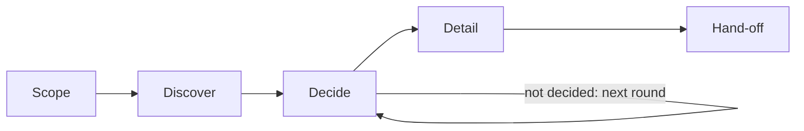
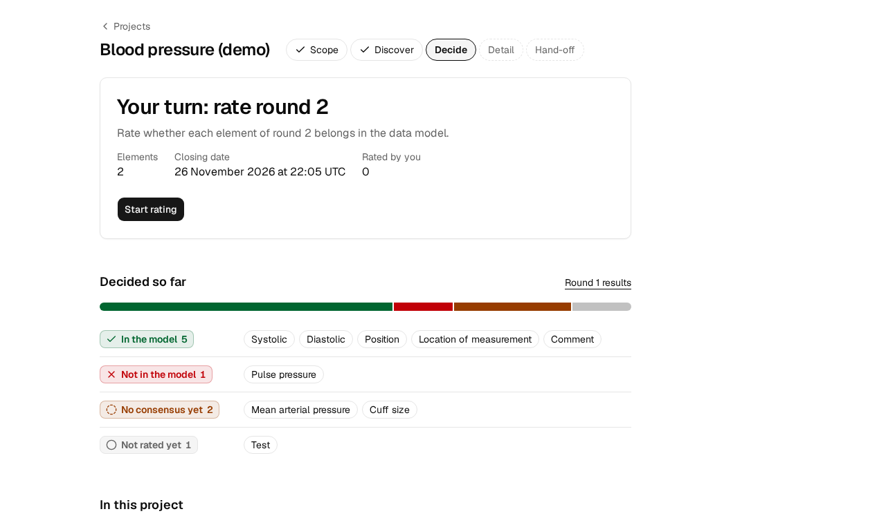
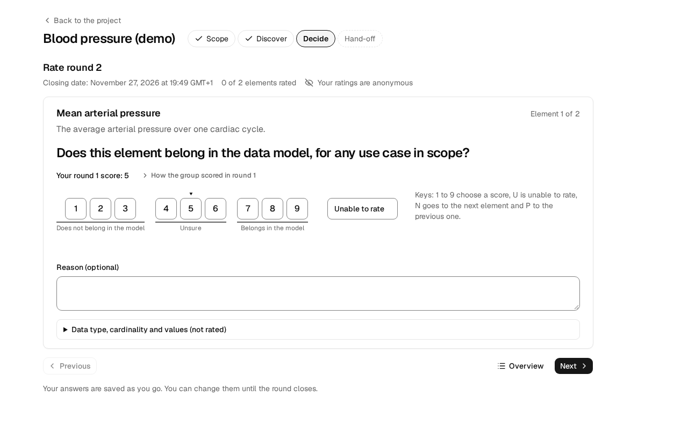
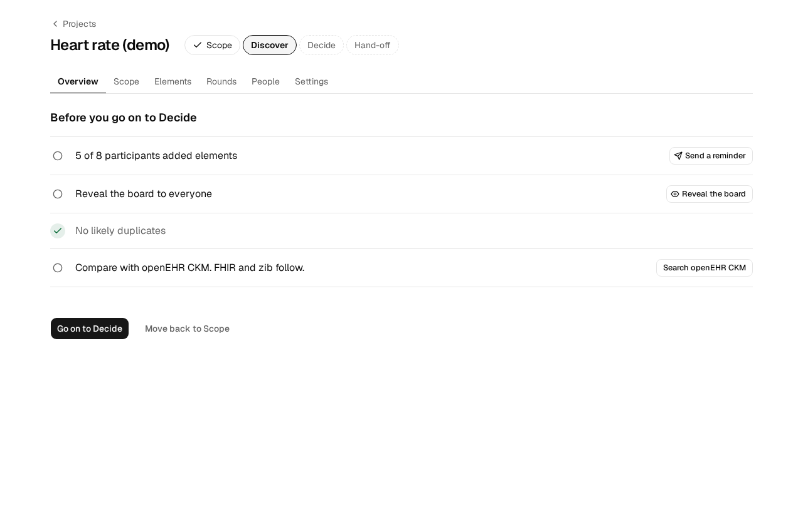

<!-- SPDX-FileCopyrightText: Sophie de Klerk -->
<!-- SPDX-License-Identifier: Apache-2.0 -->

# cdm-plenum

A common data model (CDM) describes the data of one clinical concept
independent of any standard, and a plenum is a meeting of all members: in
cdm-plenum the whole group agrees on that model together.

cdm-plenum guides a group of clinicians, information modellers and
terminologists from the scope of a clinical concept to an agreed list of data
elements, before anyone writes it down in a standard such as an openEHR
archetype or a FHIR profile. The group starts from existing models (openEHR
archetypes from the Clinical Knowledge Manager, FHIR profiles from a package
such as the Nictiz zibs), adds what is missing on a shared board, and decides
in rounds which elements belong in the model. The elements in the model then
get their structure and codes by consent. The agreed model goes to the
existing authoring tools and to CKM review as CSV and as a FreeMind mind map,
with a decision report for the study.

A project runs in one of two ways, chosen when it is created:

- **Delphi study:** participants rate each element anonymously on a scale of
  1 to 9 against a consensus rule fixed in advance, as a reportable e-Delphi
  study.
- **Team:** participants work under their own names and decide by consent:
  each element is included, left out, or discussed until the facilitator
  settles it.

What each release holds is in [CHANGELOG.md](CHANGELOG.md). The requirements
draft is in [docs/requirements.md](docs/requirements.md) and the design in
[docs/architecture.md](docs/architecture.md), with the decision records in
[docs/adr/](docs/adr/README.md).

## How it works

A project moves through five phases. The facilitator moves it on from the
project's Overview, whose checklist leads to the next open piece of work.
Participants see their task on the project home, and the page they work on
says what to do and how far they are.



| Phase | What happens |
| --- | --- |
| Scope | The facilitator writes the concept, use cases and sources, and picks the model type (observation, evaluation, instruction, action or sub-block), which sets the questions of the brainstorm. Participants comment. |
| Discover | The facilitator puts elements from existing models (CKM archetypes, FHIR profiles, forms) on the list and participants take a first look at them. Each participant then adds what is missing, alone, until the facilitator reveals the board, merges duplicates and groups the elements for the participants to check. |
| Decide | In a Delphi study, participants rate each element anonymously against a consensus rule fixed in advance; elements without consensus go to a next round with the group's scores. In a team, members answer include, leave out or discuss by name, and the facilitator settles what is left to discuss. |
| Detail | The facilitator or an architect proposes the tree of the model and, per element, the data type, cardinality, values and units, or a reference to another model. A terminologist proposes the codes, which a second terminologist reviews. Participants go through a list of the elements, one at a time, in plain words: they agree, object, or leave a technical point to the experts. A value list can go to a rating round of its own, and the facilitator settles. |
| Hand-off | Participants read the agreed model in plain words. The facilitator's Overview shows what is still open and holds the downloads: the decision report, the elements as CSV (also with semicolons for Excel) and as a mind map, and the ratings for the study report. |

## Screenshots

The screenshots show the demo projects; their people are invented.

A participant's project home shows one "Your turn" card with what to do and
by when, and what the group has decided so far.



In a Delphi study the rating card asks one question per element on a scale
of 1 to 9; the bar above it counts how far you are.



The facilitator opens a project on its Overview: a checklist for the current
phase in which the first open item is the next step, and the move to the next
phase once everything is done.



## Run it locally

You need Podman (or Docker) with compose. Node.js and pnpm run inside the
development container, so you do not install them on your machine.

```sh
scripts/dev/pnpm.sh install     # install the dependencies in the dev container
scripts/dev/compose.sh up -d    # PostgreSQL, Mailpit and the dev server
```

Open <http://localhost:3000>. Mailpit shows the e-mails the app sends at
<http://localhost:8025>. Stop the stack with `scripts/dev/compose.sh down`.

There is no open registration. To sign in for the first time, give your
address the right to create projects, then ask for a sign-in link at
<http://localhost:3000/sign-in> and open it from Mailpit:

```sh
scripts/dev/compose.sh exec dev pnpm db:migrate
scripts/dev/compose.sh exec dev pnpm admin:grant you@example.test --facilitator
```

To try every phase at once, load the demo projects. Each is a Delphi study
with the same eight invented participants in five stakeholder groups, and
stands in another phase:

| Project | Phase | What it shows |
| --- | --- | --- |
| Body temperature (demo) | Scope | A scope statement with three comments |
| Heart rate (demo) | Discover | A private brainstorm by five participants, board not revealed yet |
| Blood pressure (demo) | Decide | A closed first round with results and an open second round |
| Oxygen saturation (demo) | Detail | One settled structure with codes to answer, and one structure with an open objection |
| Respiratory rate (demo) | Hand-off | Two closed rounds; the Overview with the downloads, and the agreed model for participants |

Your address becomes facilitator of every project and administrator of the
app. A second run adds only the projects that are missing.

```sh
scripts/dev/compose.sh exec dev pnpm db:seed-demo --facilitator you@example.test
```

The participants have `example.test` addresses (for example
`nurse.a@example.test`). The development stack has a sign-in page without
e-mail at <http://localhost:3000/dev/sign-in> with one button per person, and
"Switch person" in the menu under your name opens it again
([docs/testing.md](docs/testing.md#sign-in-without-e-mail) explains it). Sign in as a
participant to see their view: their task on each project's home, the first look in
Heart rate, round 2 to rate in Blood pressure, the structure proposals to
answer in Oxygen saturation, and the agreed model in Respiratory rate.

Run the checks (typecheck, lint, unit tests) with `scripts/dev/pnpm.sh check`,
and the browser tests with `scripts/dev/e2e.sh`.
[docs/testing.md](docs/testing.md) explains the test suites, how to run part
of one, how to write a test, and a walkthrough to try the demo by hand.

## Run it in production

`compose.yaml` runs the app and PostgreSQL on one host behind a reverse
proxy with TLS. [docs/deployment.md](docs/deployment.md) covers the
settings, the first administrator, updates and backups.

## Use of AI

This project is developed with the help of an AI coding assistant (Claude
Code). The owner decides on the requirements and the design, and every change
goes through a pull request with automated checks.

## Licence

Apache License 2.0, see [LICENSE](LICENSE). Each file names its licence in an
SPDX header, and the full texts are in [`LICENSES/`](LICENSES/). The
components in `src/components/ui/` come from the shadcn/ui registry
(<https://ui.shadcn.com>) and stay under the MIT licence
([`LICENSES/MIT.txt`](LICENSES/MIT.txt)); everything else is Apache-2.0
([`LICENSES/Apache-2.0.txt`](LICENSES/Apache-2.0.txt)).
