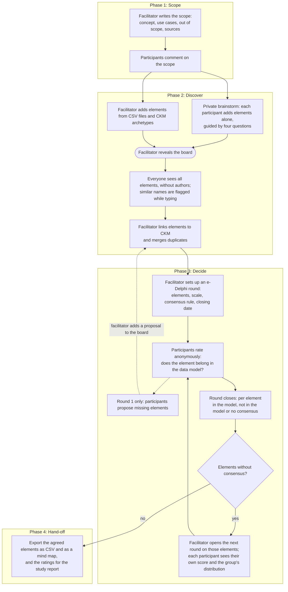
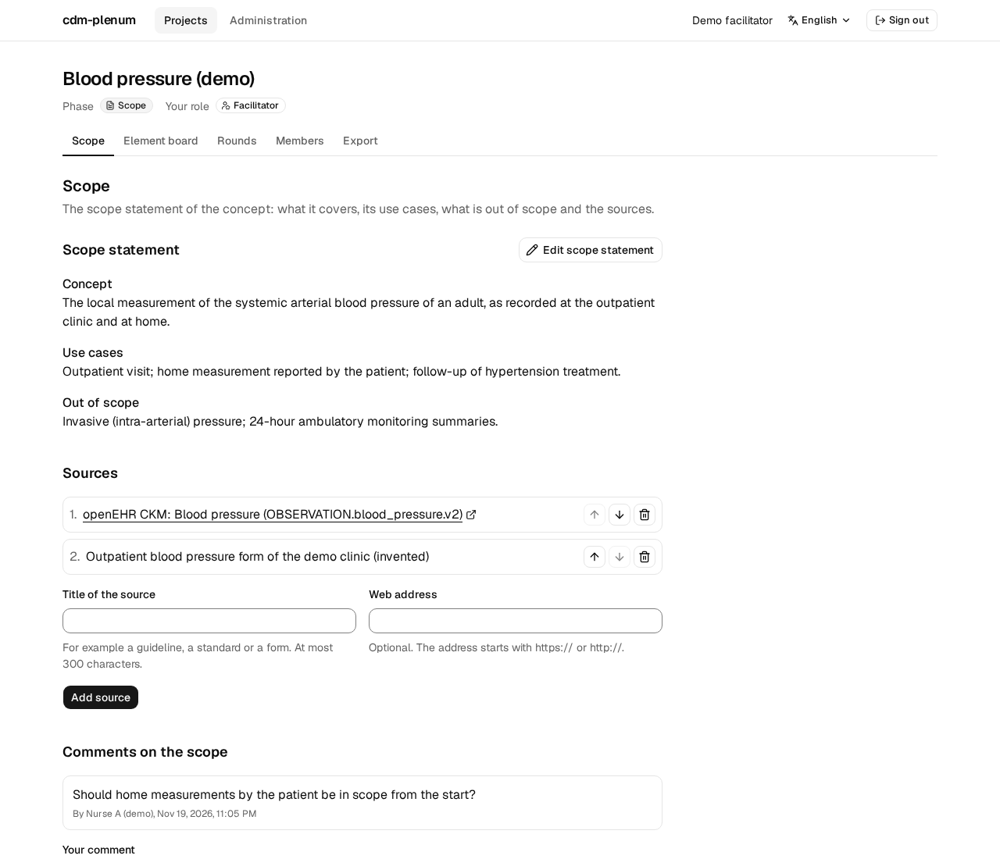
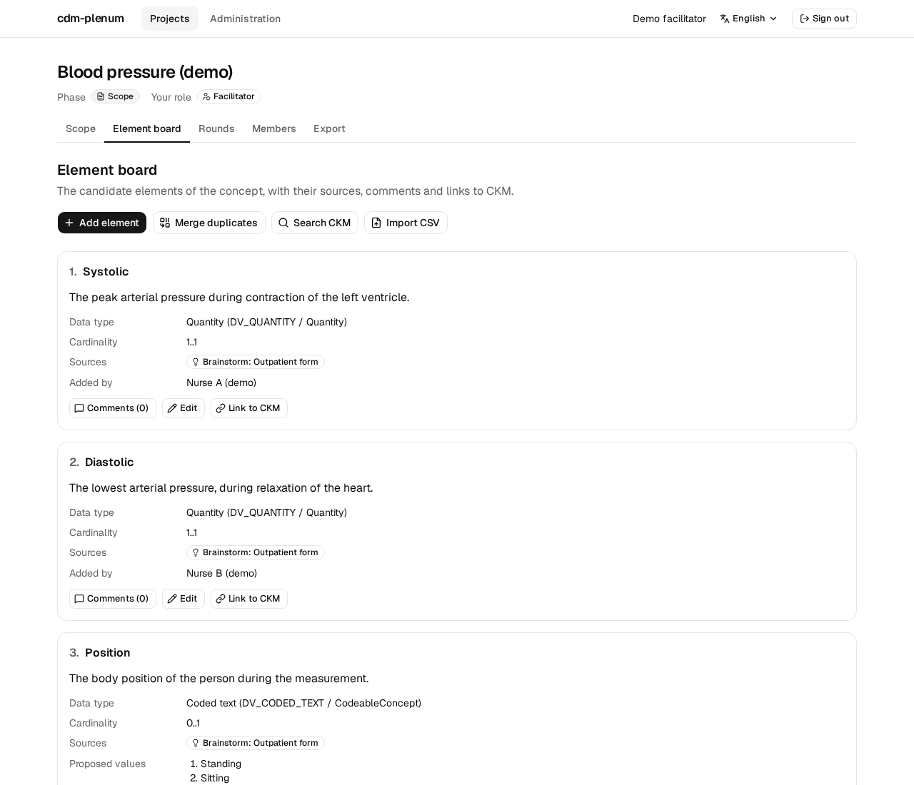
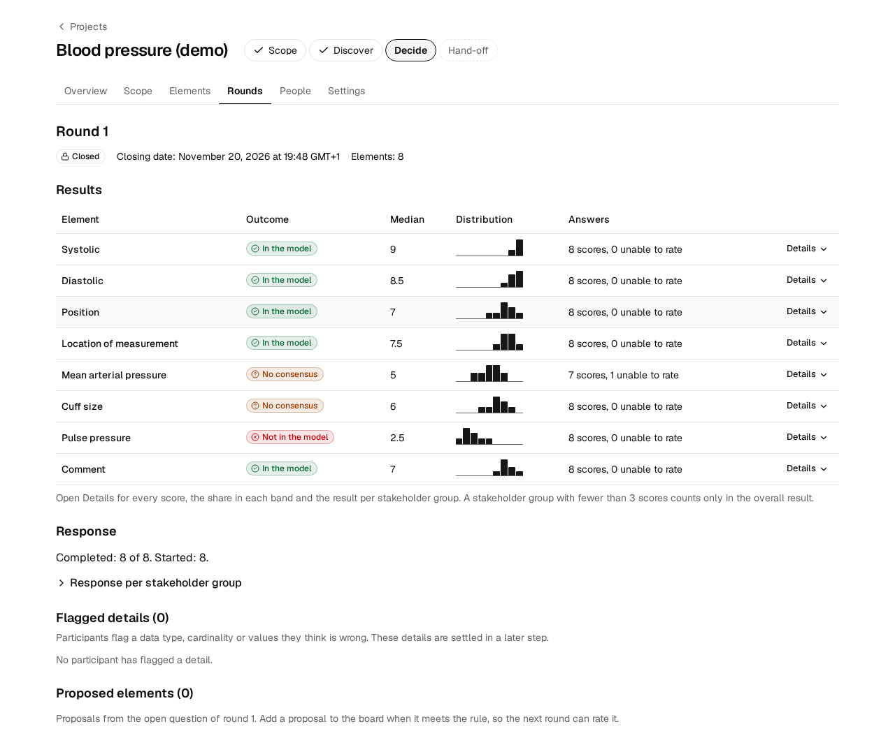
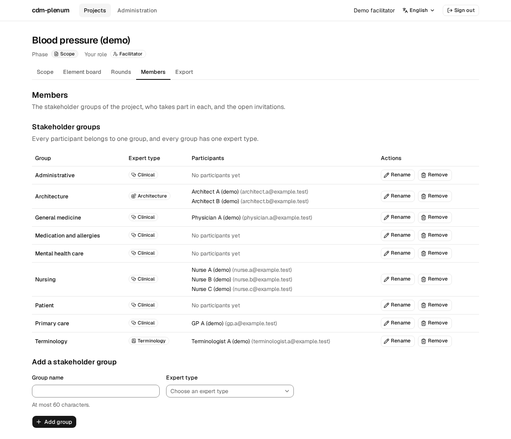

<!-- SPDX-FileCopyrightText: Sophie de Klerk -->
<!-- SPDX-License-Identifier: Apache-2.0 -->

# cdm-plenum

cdm-plenum guides a group of clinicians, information modellers and
terminologists from the scope of a clinical concept to an agreed list of data
elements, before anyone authors an openEHR archetype. The group collects
candidate elements on a shared board, checks them against existing archetypes
in the openEHR Clinical Knowledge Manager (CKM), and rates them in e-Delphi
rounds against a consensus rule fixed in advance. The agreed list goes to the
existing authoring tools and to CKM review as CSV and as a FreeMind mind map.

The project is in an early stage. The requirements draft is in
[docs/requirements.md](docs/requirements.md) and the design in
[docs/architecture.md](docs/architecture.md), with the decision records in
[docs/adr/](docs/adr/README.md).

## How it works

A project moves through four phases. The facilitator moves it on from the
project's overview, and every participant sees there what is expected of them
now.



In words: the facilitator writes the scope and participants comment on it.
In the discover phase each participant first adds elements alone, guided by
four questions, while the facilitator adds elements from CSV files and CKM.
When the facilitator reveals the board, everyone sees all elements without
their authors, and the facilitator links them to CKM and merges duplicates.
In the decide phase participants rate each element anonymously in e-Delphi
rounds; in round 1 they can also propose missing elements. Elements without
consensus go to a next round, where each participant sees their own earlier
score and the group's distribution. The agreed elements are exported for the
modellers and the ratings for the study report.

## Screenshots

The screenshots show the demo project, which `pnpm db:seed-demo` loads. Its
people and addresses are invented.

The scope page holds the concept, use cases, sources and comments.



On the element board the group collects candidate elements with their data
type, cardinality, sources and proposed values, and links them to CKM.



A participant rates each element on a scale of 1 to 9 and sees the outcome
of the previous round.


When a round closes, the facilitator sees per element the outcome under the
consensus rule, the median and every score.



The members page holds the stakeholder groups, the invitations and the
setting for what participants see.



## Run it locally

You need Podman (or Docker) with compose. Node.js and pnpm run inside the
development container, so you do not install them on your machine.

```sh
scripts/dev/pnpm.sh install     # install the dependencies in the dev container
scripts/dev/compose.sh up -d    # PostgreSQL, Mailpit and the dev server
```

Open <http://localhost:3000>. Mailpit shows the e-mails the app sends at
<http://localhost:8025>. Stop the stack with `scripts/dev/compose.sh down`.

There is no open registration. To sign in for the first time, give your
address the right to create projects, then ask for a sign-in link at
<http://localhost:3000/sign-in> and open it from Mailpit:

```sh
scripts/dev/compose.sh exec dev pnpm db:migrate
scripts/dev/compose.sh exec dev pnpm admin:grant you@example.test --facilitator
```

To try the whole flow at once, load the demo project "Blood pressure
(demo)": a scope, eight elements, eight invented participants in five
stakeholder groups, a closed first round with results, and an open second
round. Your address becomes facilitator and administrator of it; a second run
changes nothing.

```sh
scripts/dev/compose.sh exec dev pnpm db:seed-demo --facilitator you@example.test
```

The participants have `example.test` addresses (for example
`nurse.a@example.test`); sign in as one in a private window to see the
participant's view and rate in round 2.

Run the checks (typecheck, lint, unit tests) with `scripts/dev/pnpm.sh check`,
and the browser tests with `scripts/dev/e2e.sh`.
[docs/testing.md](docs/testing.md) explains the test suites, how to run part
of one, how to write a test, and a walkthrough to try the demo by hand.

## Run it in production

`compose.yaml` runs the app and PostgreSQL on one host behind a reverse
proxy with TLS. [docs/deployment.md](docs/deployment.md) covers the
settings, the first administrator, updates and backups.

## Use of AI

This project is developed with the help of an AI coding assistant (Claude
Code). The owner decides on the requirements and the design, and every change
goes through a pull request with automated checks.

## Licence

Apache License 2.0, see [LICENSE](LICENSE). Each file names its licence in an
SPDX header, and the full texts are in [`LICENSES/`](LICENSES/). The
components in `src/components/ui/` come from the shadcn/ui registry
(<https://ui.shadcn.com>) and stay under the MIT licence
([`LICENSES/MIT.txt`](LICENSES/MIT.txt)); everything else is Apache-2.0
([`LICENSES/Apache-2.0.txt`](LICENSES/Apache-2.0.txt)).
