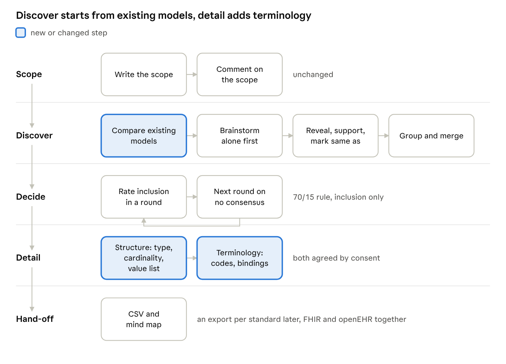
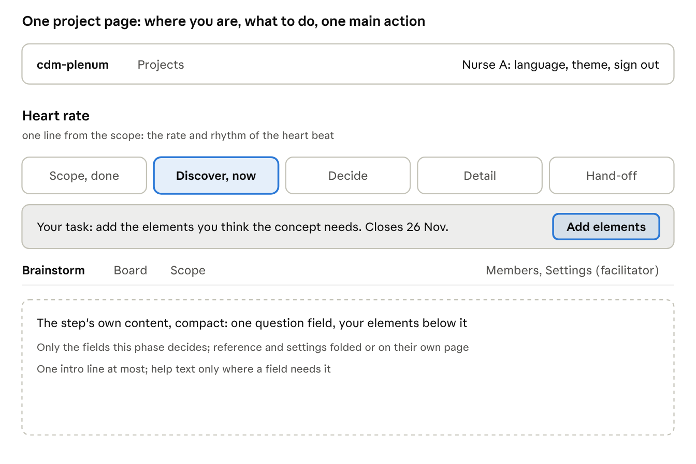

<!-- SPDX-FileCopyrightText: Sophie de Klerk -->
<!-- SPDX-License-Identifier: Apache-2.0 -->

# cdm-plenum design evaluation

2026-11-20. Accepted by the owner on 2026-11-20, with the changes noted in
section 5. Written and discussed in a shared document
(<https://claude.ai/artifact/6fXHo6dPJyrNz2E8sS24yL>); this file is the copy
kept with the code. The requirements and ADRs that follow from it cite it.

## Summary

The base holds: scope, a private brainstorm, a Delphi that rates only
inclusion, and phases that decide what each person sees. What needs a
redesign is everything that comes from or goes to existing models: details,
codes and FHIR.

- **Keep:** the five phases, the private brainstorm with its reveal, the
  inclusion-only Delphi with the COMET 70/15 rule, the consent method for
  details, and the phase rules for participants.
- **Redesign:** start discover from existing models (FHIR, openEHR, zib)
  instead of from scratch; show each element field only in the phase that
  decides it; split the detail phase into structure (data type, cardinality,
  value list) and terminology (codes, bindings); link elements to FHIR as well
  as to CKM.
- **Tidy:** the process steps on every page, a separate settings page for the
  facilitator, and a few smaller faults.

## 1. What the walkthrough shows

Nine findings, from 56 pages: every tab of the four demo projects, as
facilitator and as participant, on main of 2026-11-20. The first five are the
owner's from the test; the walkthrough confirms each.

| # | Finding | Where | Recommendation |
| --- | --- | --- | --- |
| 1 | The process steps show only on the Overview tab; every other page has a small phase badge. | Project header | Show the steps on every project page, with the current step and its task. |
| 2 | Fields show before their phase. In discover every element row says "Data type: Not decided", "Cardinality: Not decided", "CKM: Not linked", and the add form asks for data type and cardinality. | Board, add form | Show a field only from the phase that decides it (section 4). |
| 3 | It is unclear how data type and cardinality are decided, and value lists have text and an optional number, no codes. Term bindings exist nowhere. | Board, planned detail phase | Split the detail phase into structure and terminology (section 2). |
| 4 | Every participant starts from scratch; only the facilitator can import, and only from CKM. | Brainstorm, board | Start discover from existing models, with a comparison (section 3). |
| 5 | Reuse is CKM only: "Search CKM", "Link to CKM", "links to CKM" in the page text. FHIR is furthest along and missing. | Board, export | One link to an element of any source model: CKM, FHIR, zib (section 3). |
| 6 | Project settings sit on other pages: change class and minimum panel open the Rounds page, even in the scope phase; the Members page mixes groups, two settings, rating as facilitator and invitations, 2,250 px tall. | Rounds, Members | A Settings page for the facilitator; Members only people; Rounds only rounds. |
| 7 | Scope sources are titles with a link, not connected to elements or imports. | Scope | They become the source models of section 3. |
| 8 | Hand-off gives CSV, a mind map and ratings, nothing a FHIR or openEHR modeller can load. | Export | Not now. A later export per standard covers FHIR and openEHR together (owner, 2026-11-20). |
| 9 | Smaller faults: a participant opening the export URL lands on Scope, not the overview; in discover a participant can add on the Brainstorm tab and on the board; the Brainstorm page is 1.5 screens tall. | Several | Fix the redirect; add only on Brainstorm; make Brainstorm compact. |

## 2. When details, codes and bindings are decided

openEHR, FHIR and zibs all agree the content first and add codes later, by
other people. CKM's policy: "bindings and translations should not hold up
formal publication of the archetype"; "Initial terminology bindings will be
developed by binding experts" and then reviewed by a broader group
([openEHR wiki](https://openehr.atlassian.net/wiki/spaces/healthmod/pages/2949146)).

A value list has two layers. The first is the list of meanings: openEHR
at-codes, the concept names of a zib codelist, the values of an ordinal with
their numbers. The second binds those meanings to SNOMED CT or LOINC. openEHR
treats the meanings as leading and the bindings as optional
([ADL2 7.13.4 and 8.2](https://specifications.openehr.org/releases/AM/latest/ADL2.html)).
The numbers of an ordinal (DV_ORDINAL: a number with a coded symbol) belong
to the content, not to the terminology
([RM data types](https://specifications.openehr.org/releases/RM/development/data_types.html)).

FHIR, zibs and ADL2 share four binding strengths: required, extensible,
preferred and example
([FHIR R4](https://hl7.org/fhir/R4/terminologies.html#binding); ADL2 9.6.2.4;
the zib codelists, for example
[BloodPressure v5.1](<https://zibs.nl/wiki/BloodPressure-v5.1(2024EN)>)).
That gives cdm-plenum one field that stays neutral across standards.

Templates and profiles narrow an agreed model for one use case; they do not
define it. A profile "can restrict the cardinality of an element within the
limits of the base structure"
([FHIR profiling](https://hl7.org/fhir/R4/profiling.html)), and an openEHR
template mostly narrows occurrences. A common data model is the maximal
layer, so its cardinality is the widest one any use case needs; the narrowing
stays with each implementation.

| What | Phase | Proposes | Decides |
| --- | --- | --- | --- |
| Inclusion of the element | Decide | everyone, in the brainstorm | the panel, in Delphi rounds (70/15) |
| Data type, in neutral words (text, coded, ordinal, quantity with unit, count, date and time, yes/no, identifier) | Detail: structure | information modeller | the group, by consent |
| Cardinality, the widest any use case needs | Detail: structure | modeller | the group, by consent |
| Value list: the meanings, ordinal numbers, units | Detail: structure | modeller with clinicians | the group, by consent; a rating round for a long or contested list |
| Codes for the element and its values (SNOMED CT, LOINC) and the binding strength | Detail: terminology, once the list is stable | terminologist | a second terminologist reviews, the group checks the meaning; does not hold up the hand-off |
| Narrowing for a use case (template, profile) | outside cdm-plenum | implementers | not here; hand-off notes only |

No standard prescribes this order for a group; it is our own design, built on
the order the sources above share.

## 3. Start from existing models, FHIR next to CKM

The long list should start from the models that exist, read by the tool, so
nobody copies a profile or an archetype by hand. For most concepts FHIR
profiles exist, often several, none of them maximal: the comparison below
shows them side by side, and their union is the start of the long list. All
three sources can be read by machine:

- **FHIR:** packages are npm-style archives on the
  [FHIR package registry](https://hl7.org/fhir/packages.html), for example
  [nictiz.fhir.nl.r4.zib2020](https://packages.fhir.org/nictiz.fhir.nl.r4.zib2020).
  A StructureDefinition's snapshot lists each element with its type,
  `min..max`, an element code and its binding
  ([ElementDefinition](https://hl7.org/fhir/R4/elementdefinition.html)). A
  logical model (`kind = logical`) is the neutral form, as zibs and IPS use.
- **openEHR:** cdm-plenum already reads CKM archetypes through the CKM REST
  API. An HL7 test build also shows archetypes as FHIR logical models, for
  example
  [blood pressure v2](https://build.fhir.org/ig/FHIR/openehr-test/en/StructureDefinition-openEHR-EHR-OBSERVATION.blood-pressure.v2.html);
  it is a test build, so not a source to rely on.
- **zib:** the zib FHIR profiles carry a mapping from each FHIR element back
  to its zib concept id (NL-CM), and each zib element has a definition code in
  LOINC or SNOMED CT, for example systolic pressure LOINC 8480-6
  ([zib BloodPressure](<https://zibs.nl/wiki/BloodPressure-v5.1(2024EN)>)).

### The proposed step: compare and pre-seed

At the start of discover, before the private brainstorm, the facilitator
picks the source models: a FHIR package and one or more profiles or logical
models in it, CKM archetypes, zibs. A participant can suggest a source model
for the facilitator to import. The tool then:

1. **Imports** each source's elements with name, definition, type,
   cardinality, element code and binding, leaving out FHIR infrastructure such
   as `id`, `meta` and `extension`.
2. **Matches** elements across sources: first on the same LOINC or SNOMED CT
   element code, then on a declared mapping (zib profile to NL-CM), then on a
   similar name. Only a code match counts; the rest are suggestions the
   facilitator confirms.
3. **Shows a coverage table:** one row per candidate element, one column per
   source model, each cell with that model's type, cardinality and binding,
   so the group sees at once where the models differ.

Imported elements land on the board marked with their source and go into the
Delphi like any other element: a source fills the long list; it does not
decide what belongs in the model. The private brainstorm stays, for what no
model has yet.

### One link, any standard

The CKM link becomes a link to an element of a source model, of three kinds:
an openEHR archetype element (archetype id, at-code, revision), a FHIR element
(package, version, canonical URL, element path) and a zib concept (NL-CM id,
zib version). An element can carry several. The detail phase starts its
proposals from the linked elements, with the differences between them
flagged.

## 4. The proposed process

The five phases stay; discover starts with a comparison of existing models,
and detail gets a terminology step after the structure step.

Read each phase left to right; the arrow under Decide is the loop to a next
round for elements without consensus.

Each element field shows from the phase that decides it, and not before:

| Field | Scope | Discover | Decide | Detail | Hand-off |
| --- | --- | --- | --- | --- | --- |
| Name, description | | add, edit | read | read | export |
| Brainstorm question, sources, links to source models | | add | read | read | export |
| Support, same as | | mark, after the reveal | | | |
| Inclusion rating | | | rate | read | export |
| Data type, cardinality, value list | | | | propose, consent | export |
| Codes, binding strength | | | | propose, review | export |

## 5. Decisions

| # | Decision | Recommendation | Why |
| --- | --- | --- | --- |
| D1 | Start discover from existing models, with import, matching and a coverage table | Yes. First FHIR packages (which hold the zib profiles and IPS) and CKM archetypes; zib concept ids through the zib FHIR profiles. The facilitator imports; a participant can suggest a source model for the facilitator to import. | Nobody copies by hand; the group sees where models differ before it brainstorms. |
| D2 | Split the detail phase into two steps: structure (data type, cardinality, value list), then terminology (codes and bindings) | Yes, both in the detail phase, terminology after structure. | Matches CKM, FHIR and zib practice; terminologists work on a stable list. |
| D3 | How a value list is agreed | Consent by default; a rating round per list when it is long or contested (the planned DT3). | Most lists are uncontested; a few deserve a vote on each value. |
| D4 | The terminology fields | An element code, a code per value, the code system, a binding strength (required, extensible, preferred, example) and an optional value set URL. | The four strengths are shared by FHIR, zib and ADL2. |
| D5 | FHIR links next to CKM links | Yes: one link to a source-model element, three kinds; raise EL10 and EL11 (FHIR link and import) from Should and Could to Must. | FHIR is furthest along; a CKM-only tool reads as openEHR-only. |
| D6 | Fields per phase | As in section 4: discover shows name, description, sources and question; data type, cardinality and values appear in detail. | Nothing shows before it can be decided. |
| D7 | Process steps on every page | Yes, compact, in the project header. | The owner's finding; one look tells where the project is. |
| D8 | A Settings page for the facilitator | Yes: change class, minimum panel, private brainstorm, group names; Members keeps people and invitations. | Rounds and Members shrink to their own task. |

Accepted by the owner on 2026-11-20, with two changes from the comments: only
the facilitator imports source models in D1, participants suggest them; and
no export per standard for now, and when one comes it covers FHIR and openEHR
together.

## 6. What it changes

| Work | State on 2026-11-20 | Effect |
| --- | --- | --- |
| Detail phase (DT1, DT2) | paused, partly built | Rework into structure and terminology steps (D2, D4) before it continues. |
| Support and same-as marks (EL16) | merged (#45) | None; it works on the board as it is. |
| Friendlier rating card | merged (#44) | None; the Delphi still rates inclusion. |

Requirements to change, each with an ADR:

- **New:** a compare-and-pre-seed step at the start of discover (D1),
  terminology fields and a terminology step (D2, D4), the process steps on
  every page (D7) and a Settings page (D8).
- **Rewritten:** EL4 and EL7 (CKM link and import) become one link to a
  source-model element; EL12 (sources) becomes the source models of D1; DT1
  and DT2 get the two steps; EL1 drops data type and cardinality from adding an
  element (D6).
- **Raised:** EL10 and EL11 (FHIR link and import) to Must (D5); DT3 (a rating
  round for a value list) from Could to Should (D3).
- **Fixes, no decision needed:** the participant's export redirect, adding
  only on the Brainstorm tab in discover, a more compact Brainstorm page.

## 7. Simpler pages

The owner's test after the latest builds: better, but still denser and more
complex than needed. Six principles, then what they change per page; D6, D7
and D8 carry most of it.

1. **One task per page.** A page opens with what the person does now;
   reference material is folded or one click away.
2. **Only what the phase and role need.** Later steps hidden (built), fields
   only from the phase that decides them (D6).
3. **Fewer words.** At most one intro line per page; help text only under a
   field that needs it; no sentence repeated across pages.
4. **Settings off task pages** (D8).
5. **Where you are, always** (D7): the steps and the task line replace the
   Phase and Role badges.
6. **One main button** per page; other actions in a menu or in an item's
   details.

The header carries the place and the task; the content below it does one job.

| Page | Now | Simpler |
| --- | --- | --- |
| Top bar | name, Projects, Administration, theme, language, sign out side by side | one menu under the person's name: language, theme, sign out; Administration only for administrators |
| Project header | name, Phase and Role badges, up to 8 tabs | name, one line of the scope, the steps, the task line with its button, tabs for the current work; Members and Settings at the far end, facilitator only |
| Overview | its own row of steps and a task card | gone as a tab: the header now holds both; the project opens on the current step's page |
| Scope | statement, sources form, comments, all open | the statement to read; comments folded with a count; sources move to the compare step (D1) |
| Brainstorm | four questions, each with its own form, 1.5 screens | one field with a choice of question; your elements below, grouped by question |
| Board | 8 columns, data type and cardinality from the start | in discover: name, description, question, sources, support (facilitator); detail columns only in detail |
| Rounds | change class and minimum panel above the rounds | the list of rounds only; panel settings on the Settings page, shown again when a round opens below the minimum |
| Members | groups, two settings, rating as facilitator, invitations, 2,250 px | people per group in one table; invite in a dialog; only pending invitations listed |
| Rating card | built in #44 | keep; Next must stay on the first screen after a choice |

## Sources

Opened and checked on 2026-11-20:

- [COMET Handbook 1.0](https://doi.org/10.1186/s13063-017-1978-4), Williamson
  et al., Trials 2017: section 2.1 on "what" before "how", and the 70/15
  consensus definition with its rationale (full text via Europe PMC).
- [openEHR: Authoring, Review and Publication Overview](https://openehr.atlassian.net/wiki/spaces/healthmod/pages/2949146):
  bindings do not hold up publication.
- [openEHR ADL2](https://specifications.openehr.org/releases/AM/latest/ADL2.html),
  sections 7.13.4, 8.2, 9.6.2.4 and 10.1;
  [openEHR AM overview](https://specifications.openehr.org/releases/AM/development/Overview.md);
  [openEHR RM data types](https://specifications.openehr.org/releases/RM/development/data_types.html).
- [FHIR R4 terminologies: binding](https://hl7.org/fhir/R4/terminologies.html#binding),
  [profiling](https://hl7.org/fhir/R4/profiling.html),
  [ElementDefinition](https://hl7.org/fhir/R4/elementdefinition.html),
  [packages](https://hl7.org/fhir/packages.html),
  [structure definition kinds](https://hl7.org/fhir/R4/codesystem-structure-definition-kind.html).
- [zib BloodPressure v5.1](<https://zibs.nl/wiki/BloodPressure-v5.1(2024EN)>);
  [nictiz.fhir.nl.r4.zib2020 on the package registry](https://packages.fhir.org/nictiz.fhir.nl.r4.zib2020);
  [zib 2017 IG, blood pressure mappings](https://hl7nl.github.io/Nictiz-STU3-ZIb2017-IG/StructureDefinition-zib-BloodPressure-mappings.html).
- [openEHR test IG: blood pressure as a FHIR logical model](https://build.fhir.org/ig/FHIR/openehr-test/en/StructureDefinition-openEHR-EHR-OBSERVATION.blood-pressure.v2.html)
  (a continuous build, not authoritative).

Not verified: ISO 13972 (paywalled), the Nictiz review process for new zibs
(the PDF returned 404), the mapping arrays in the R4 zib2020 snapshot (the
package server was blocked), ART-DECOR's dataset model (search summary only).
Check these before building on them.
